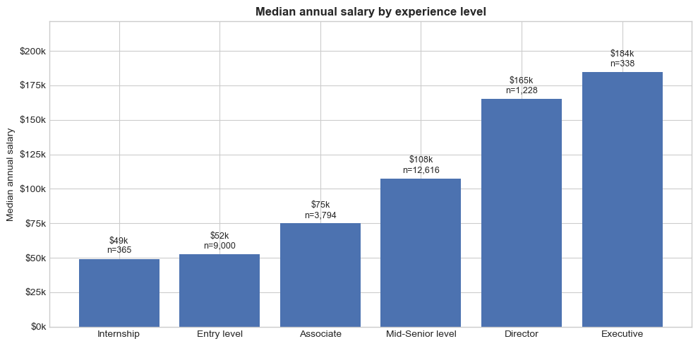
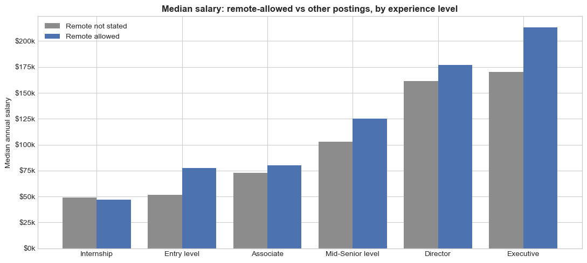
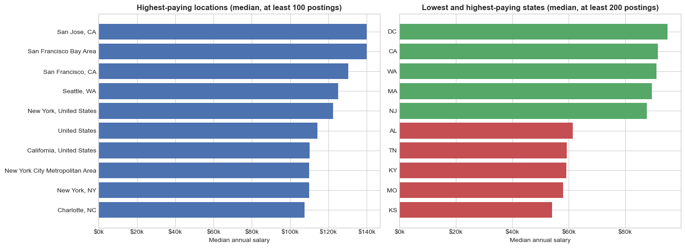

# What Drives Salaries? US Job Postings

An analysis of about 124,000 LinkedIn job postings from 2023–2024 in pandas and Matplotlib, asking which factors are linked to the salary a US job offers: **experience level, location, work type or remote work**.

## The problem

The data comes as five separate files linked by `job_id`, two of them padded with noise columns. Only 29% of postings state a salary, and those that do quote it per hour, week, month or year, sometimes with obvious entry errors (*"200–225"* for a principal engineer). Before comparing anything, the data has to be merged, put on one annual scale and cleaned.

## Approach

1. **Merging:** checked what each file holds and joined four of them on `job_id` (the fifth repeats columns another file already has; it matches about 99% of the time). I then confirmed that all 123,849 postings survived with no duplicates.
2. **Cleaning:**
   - kept US-dollar postings that state a salary
   - took one figure per posting (the stated median, else the midpoint of the range)
   - converted everything to an annual amount (hourly pay at 2,080 hours a year)
   - removed values below the full-time federal minimum wage ($15,080), which are entry errors, and the top 1%
   - 35,241 postings remain
3. **Analysis:** compared **median** salaries (salaries are right-skewed) across experience levels, locations, work types and remote status, always with the number of postings behind each figure.

## Results

| Factor | Finding (median annual salary) |
|---|---|
| **Experience level** | The strongest link: $48,880 for internships up to $184,500 for executives, about 3.8 times |
| **Location** | Bay Area ($130,000–140,000) and Seattle ($125,000) highest; the top state (DC) is about 1.75 times the lowest (Kansas) |
| **Remote work** | Remote-allowed postings: $112,500 vs $77,500, and higher at every level except internships |
| **Work type** | Contract roles have the highest full-time-equivalent rate ($98,800); part-time ($42,640) and internships the lowest |

Salary rises at every step up the career ladder:



Remote-allowed jobs pay more even when comparing the same experience level:



## The ranking mistake I fixed

My first version ranked locations by **average** salary with no minimum number of postings. Every location in that "top 10" turned out to have just one or two postings: a single $300,000 job in Black River Falls, Wisconsin came first. After requiring at least 100 postings per location and using medians, the real picture appears:



I also fixed a few other things from that version:
- **Averages swapped for medians:** averages are pulled up by a long tail of high salaries.
- **Box plot relabelled:** it was described as showing "the middle 80%", which box plots don't show.
- **Pie chart removed:** it showed *average* applications per work type, and averages can't be read as parts of a whole.
- **Minimum-wage filter added:** it catches the entry errors that the 1% trim missed.

## What I learned

- Check group sizes before ranking groups. A ranking built on one posting per group is noise.
- Use medians for skewed data like salaries.
- Look at what a chart actually shows before writing conclusions about it.

## Limitations and what I'd improve

- **Only 29% of postings state a salary,** and they may not be typical. States with pay-transparency laws are likely over-represented.
- **These are associations, not causes.** Experience, location, remote work and job field are tangled together. A regression model could estimate each factor's effect while holding the others fixed.
- **Hourly rates are converted at 40 hours a week,** which overstates what part-time workers earn in a year.
- **Location labels are inconsistent** ("New York, NY" vs "New York City Metropolitan Area"). Mapping them to metro areas would make location comparisons cleaner.

## Run it

```bash
pip install -r requirements.txt
jupyter notebook us_salary_analysis.ipynb
```

The notebook keeps its outputs, so you can read every chart and result without running it.

## Data

The data is about 1 GB, so it isn't included; see [`data/README.md`](data/README.md). It comes from the public [LinkedIn Job Postings (2023–2024)](https://www.kaggle.com/datasets/arshkon/linkedin-job-postings) dataset on Kaggle, by Arsh Koneru.
